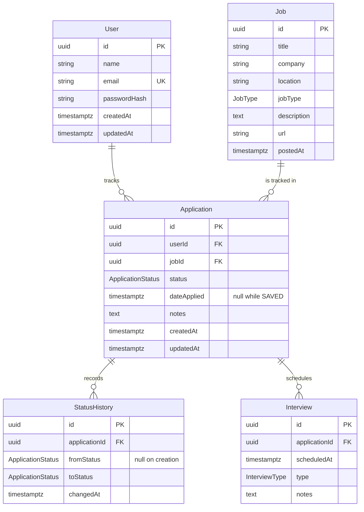

# Job Application Tracker — Backend

A REST API that helps college students and recent graduates keep every job application, status
change, and interview in one place.


---

## About

Job hunting means applying to dozens of positions at once. Each one moves at its own pace
through saved, applied, interviewing, offer, or rejected, and spreadsheets and inboxes quickly
stop being enough. It gets hard to remember where you applied, what changed, and what's coming
up next.

This project is the backend for a dashboard built for **college students and recent graduates**.
Users save jobs, log applications, update their status as they hear back, schedule interviews,
and see everything summarized on one dashboard.

It was built by **Group 4** as a course project that reimagines application management on
Indeed: what tracking your applications could look like if it were designed around the job
seeker.

**Team:** Cayden Willey · Dhruv Patel · Hudson Floyd-Evans · Jack Lucania · Sebastian Boscan Villalobos

> [!IMPORTANT]
> **This project is not affiliated with, endorsed by, or connected to Indeed.** It does not use
> Indeed's API or data. All job listings are mock data created by the seed script
> (`prisma/seed.ts`). Company names belong to real employers, but every listing is fictional.

## Features

- **Authentication**: email and password sign-up and login, passwords hashed with argon2, and
  the session kept in an httpOnly JWT cookie. `/api/auth/*` is rate-limited.
- **Application tracking**: track any job with a status and notes, filter by status (including
  "Saved Jobs"), search by title or company, sort, and paginate. Per-status counts are available
  for tab badges.
- **Status history**: every status change is recorded in the same transaction as the update.
  `dateApplied` is set automatically the first time an application leaves `SAVED`.
- **Interviews**: schedule, update, and remove phone, virtual, or onsite interviews for each
  application.
- **Dashboard summary**: Total, In Progress, Interview, and Offer cards, the five most recent
  applications, and the next three interviews, all from one request.
- **Job search**: browse the job listings with case-insensitive search over title and company,
  a job type filter, and pagination. Each job shows the current user's status for it.
- **Built to be safe by default**: Zod validation on every route (unknown fields are rejected),
  per-user data isolation (another user's resources return 404), helmet headers, CORS limited to
  the frontend, CSRF origin checks, and request logs that never contain passwords or cookies.

## Tech Stack

| Area          | Technology                                                                                                                                                       |
| ------------- | ---------------------------------------------------------------------------------------------------------------------------------------------------------------- |
| Runtime       | [Node.js](https://nodejs.org/) 20+                                                                                                                               |
| Language      | [TypeScript](https://www.typescriptlang.org/) (strict mode)                                                                                                      |
| Web framework | [Express](https://expressjs.com/) 5                                                                                                                              |
| Database      | [PostgreSQL](https://www.postgresql.org/) 16 (Docker Compose locally)                                                                                            |
| ORM           | [Prisma](https://www.prisma.io/) 7 with the `pg` driver adapter                                                                                                  |
| Validation    | [Zod](https://zod.dev/) 4                                                                                                                                        |
| Auth          | [argon2](https://github.com/ranisalt/node-argon2) password hashing, JWT via [jose](https://github.com/panva/jose) in an httpOnly cookie                          |
| Security      | [helmet](https://helmetjs.github.io/), [cors](https://github.com/expressjs/cors), [express-rate-limit](https://github.com/express-rate-limit/express-rate-limit) |
| Logging       | [pino](https://getpino.io/) + [pino-http](https://github.com/pinojs/pino-http)                                                                                   |
| API docs      | OpenAPI 3 ([`docs/openapi.yaml`](docs/openapi.yaml)) served with [Swagger UI](https://swagger.io/tools/swagger-ui/)                                              |
| Testing       | [Vitest](https://vitest.dev/) + [Supertest](https://github.com/ladjs/supertest), V8 coverage                                                                     |
| Code quality  | [ESLint](https://eslint.org/) (typescript-eslint strict) + [Prettier](https://prettier.io/)                                                                      |
| Deployment    | [Render](https://render.com/) Blueprint ([`render.yaml`](render.yaml))                                                                                           |

## Getting Started

### Prerequisites

- [Node.js](https://nodejs.org/) **20 or newer** (`node -v`)
- npm (bundled with Node.js)
- [Docker](https://docs.docker.com/get-docker/) with Docker Compose, for the local databases

### Setup

1. **Clone the repository**

   ```bash
   git clone <repository-url>
   cd <repository-folder>
   ```

2. **Install dependencies.** This also generates the Prisma client.

   ```bash
   npm install
   ```

3. **Create your environment file**

   ```bash
   cp .env.example .env
   ```

   The defaults match `docker-compose.yml`. Before deploying anywhere, replace `JWT_SECRET` with
   a long random value:
   `node -e "console.log(require('crypto').randomBytes(48).toString('base64url'))"`

4. **Start PostgreSQL.** This starts a dev database on port 5432 and a test database on port 5433.

   ```bash
   docker compose up -d
   ```

5. **Run the database migrations**

   ```bash
   npm run db:migrate
   ```

6. **Seed the mock data**: 40 job listings and a demo account.

   ```bash
   npm run db:seed
   ```

7. **Start the dev server** (reloads on changes)

   ```bash
   npm run dev
   ```

   The API is at <http://localhost:3000>. Check it with `curl http://localhost:3000/api/health`,
   and browse the interactive API docs at <http://localhost:3000/api/docs>.

### Demo login

> [!NOTE]
> **For local demos only.** These credentials come from `SEED_DEMO_PASSWORD` in `.env.example`.
> Use a different password for any deployed environment (see [DEPLOY.md](DEPLOY.md)).

| Email              | Password       |
| ------------------ | -------------- |
| `demo@example.com` | `DemoPass123!` |

The demo account (Cayden Willey) matches the dashboard mockup: 12 tracked applications (5 In
Progress, 4 Interview, 3 Offer), 4 saved jobs, and 2 upcoming interviews.

## Environment Variables

Defined and validated in [`src/config/env.ts`](src/config/env.ts). The server refuses to start
if any value is invalid. Copy [`.env.example`](.env.example) to get started.

| Name                        | Required    | Default                    | Description                                                                                                                    |
| --------------------------- | ----------- | -------------------------- | ------------------------------------------------------------------------------------------------------------------------------ |
| `NODE_ENV`                  | No          | `development`              | `development`, `test`, or `production`. Production turns on Secure cookies and turns off `/api/docs`.                          |
| `PORT`                      | No          | `3000`                     | Port the server listens on.                                                                                                    |
| `DATABASE_URL`              | **Yes**     | —                          | PostgreSQL connection string (`postgres://` or `postgresql://`).                                                               |
| `JWT_SECRET`                | **Yes**     | —                          | Secret for signing session tokens. At least 32 characters.                                                                     |
| `JWT_EXPIRES_IN`            | No          | `7d`                       | Session length, as a number plus `s`, `m`, `h`, `d`, or `w` (e.g. `12h`).                                                      |
| `FRONTEND_URL`              | No          | `http://localhost:5173`    | Frontend origin(s) allowed by CORS and the CSRF origin check. Comma-separated.                                                 |
| `COOKIE_SAMESITE`           | No          | `lax`                      | Auth cookie SameSite: `lax`, `strict`, or `none`. `none` is for a frontend on another site and requires `NODE_ENV=production`. |
| `LOG_LEVEL`                 | No          | `info` (`silent` in tests) | `fatal`, `error`, `warn`, `info`, `debug`, `trace`, or `silent`.                                                               |
| `BODY_LIMIT`                | No          | `100kb`                    | Max JSON body size (e.g. `100kb`, `1mb`). Larger requests get 413.                                                             |
| `TRUST_PROXY`               | No          | `0`                        | Number of reverse proxies in front of the app. Set to `1` on Render or Railway.                                                |
| `SHUTDOWN_TIMEOUT_MS`       | No          | `10000`                    | How long graceful shutdown waits for in-flight requests.                                                                       |
| `AUTH_RATE_LIMIT_MAX`       | No          | `20`                       | Max requests per IP to `/api/auth/*` per window.                                                                               |
| `AUTH_RATE_LIMIT_WINDOW_MS` | No          | `900000`                   | Rate-limit window (15 minutes).                                                                                                |
| `SEED_DEMO_PASSWORD`        | For seeding | —                          | Demo account password. Read only by `db:seed`, `db:reset`, and `demo:reset`, not by the server.                                |

## Scripts

| Script                    | What it does                                                                                                   |
| ------------------------- | -------------------------------------------------------------------------------------------------------------- |
| `npm run dev`             | Starts the server with auto-reload (`tsx watch`).                                                              |
| `npm run build`           | Generates the Prisma client and compiles TypeScript to `dist/`.                                                |
| `npm start`               | Runs the compiled server (`dist/server.js`).                                                                   |
| `npm run start:prod`      | Applies pending migrations (`prisma migrate deploy`), then starts the compiled server. Used in production.     |
| `npm test`                | Runs the test suite once.                                                                                      |
| `npm run test:watch`      | Runs the tests in watch mode.                                                                                  |
| `npm run test:coverage`   | Runs the tests with coverage. Fails if any service is below 80%.                                               |
| `npm run lint`            | Runs ESLint, then the TypeScript type check.                                                                   |
| `npm run typecheck`       | Runs the TypeScript type check only.                                                                           |
| `npm run format`          | Formats every file with Prettier.                                                                              |
| `npm run format:check`    | Checks formatting without changing files.                                                                      |
| `npm run db:migrate`      | Creates and applies migrations on the dev database, then regenerates the client.                               |
| `npm run db:seed`         | Seeds mock jobs and the demo account. Safe to run more than once.                                              |
| `npm run db:reset`        | Drops and recreates the dev database, reapplies migrations, and seeds. **Deletes all dev data.**               |
| `npm run db:generate`     | Regenerates the Prisma client.                                                                                 |
| `npm run db:test:migrate` | Applies migrations to the test database.                                                                       |
| `npm run demo:reset`      | Restores the demo account before a presentation. Dry run unless you pass `-- --yes`. Leaves other users alone. |
| `postinstall`             | Runs automatically after `npm install` to generate the Prisma client.                                          |

## Testing

Tests run against the separate **test database** (`db-test` in `docker-compose.yml`, port 5433,
configured by `.env.test`). They never touch your dev data.

```bash
docker compose up -d db-test   # if it isn't already running
npm test
```

> [!NOTE]
> The test database keeps its data **in memory** (tmpfs), so its tables disappear whenever the
> container restarts. `npm test` reapplies the migrations automatically before each run, so
> there's nothing extra to do for tests. If you use the test database outside the test runner,
> for example to inspect it, run `npm run db:test:migrate` after each restart first.

Beyond the feature tests, the suite also checks that:

- every route has Zod validation and authentication, and every user-owned query is scoped by
  `userId` (`tests/security.test.ts`)
- `docs/openapi.yaml` matches the real routes, inputs, and responses in both directions
  (`tests/openapi.contract.test.ts`)
- one user can never read, change, or delete another user's applications
  (`tests/applications.isolation.test.ts`)
- the production server and demo reset script behave correctly as real processes
  (`tests/production.test.ts`)

Run `npm run test:coverage` for a coverage report; an HTML version is written to `coverage/`.

## API Overview

All routes are under `/api`. Protected routes need the `token` cookie that register and login
set. With `fetch`, use `credentials: 'include'`.

**Interactive docs:** run `npm run dev` and open <http://localhost:3000/api/docs> (development
only). The full contract is in [`docs/openapi.yaml`](docs/openapi.yaml).

| Method   | Route                                           | Auth   | Description                                                                 |
| -------- | ----------------------------------------------- | ------ | --------------------------------------------------------------------------- |
| `GET`    | `/api/health`                                   | Public | Health check                                                                |
| `POST`   | `/api/auth/register`                            | Public | Create an account and start a session                                       |
| `POST`   | `/api/auth/login`                               | Public | Log in and start a session                                                  |
| `POST`   | `/api/auth/logout`                              | Public | End the session                                                             |
| `GET`    | `/api/me`                                       | Cookie | Get the logged-in user                                                      |
| `PATCH`  | `/api/me`                                       | Cookie | Update the logged-in user's name                                            |
| `GET`    | `/api/jobs`                                     | Cookie | List and search jobs (`q`, `jobType`, `page`, `pageSize`)                   |
| `GET`    | `/api/jobs/:id`                                 | Cookie | Get one job                                                                 |
| `GET`    | `/api/applications`                             | Cookie | List your applications (`status`, `q`, `sort`, `order`, `page`, `pageSize`) |
| `POST`   | `/api/applications`                             | Cookie | Track a job (`jobId`, optional `status` and `notes`)                        |
| `GET`    | `/api/applications/stats/by-status`             | Cookie | Count your applications per status (optional `q`)                           |
| `GET`    | `/api/applications/:id`                         | Cookie | Get one application with its job, status history, and interviews            |
| `PATCH`  | `/api/applications/:id`                         | Cookie | Update status and/or notes                                                  |
| `DELETE` | `/api/applications/:id`                         | Cookie | Delete an application (and its history and interviews)                      |
| `POST`   | `/api/applications/:id/interviews`              | Cookie | Add an interview                                                            |
| `PATCH`  | `/api/applications/:id/interviews/:interviewId` | Cookie | Update an interview                                                         |
| `DELETE` | `/api/applications/:id/interviews/:interviewId` | Cookie | Delete an interview                                                         |
| `GET`    | `/api/dashboard/summary`                        | Cookie | Dashboard cards, recent applications, and upcoming interviews               |

### Response shapes

**Errors** always look like this. `details` is present when there's more to say, such as the
validation issues:

```json
{ "error": { "code": "VALIDATION_ERROR", "message": "Request validation failed", "details": [] } }
```

Common codes: `VALIDATION_ERROR`, `BAD_REQUEST`, `UNAUTHORIZED`, `INVALID_CREDENTIALS`,
`NOT_FOUND`, `EMAIL_TAKEN`, `APPLICATION_EXISTS`, `FORBIDDEN_ORIGIN`, `PAYLOAD_TOO_LARGE`,
`RATE_LIMITED`, and `INTERNAL_ERROR`.

**Lists** are paginated (`pageSize` defaults to 20, max 50):

```json
{ "data": [], "page": 1, "pageSize": 20, "total": 0 }
```

Dates are ISO 8601 strings in UTC.

## Data Model

Defined in [`prisma/schema.prisma`](prisma/schema.prisma).

- **User**: an account: name, unique email (stored lowercase), and argon2 password hash. The
  hash is never returned by the API.
- **Job**: a mock job listing: title, company, location, job type (`INTERNSHIP`, `PART_TIME`,
  `FULL_TIME_ENTRY`), description, URL, and posting date. Job listings aren't owned by any user.
- **Application**: one user's tracking of one job: status, notes, and `dateApplied`. A user can
  have at most one application per job. "Saved Jobs" are applications with status `SAVED`.
- **StatusHistory**: one row per status change (`fromStatus` → `toStatus`, `changedAt`). The
  first row, written at creation, has `fromStatus = null`.
- **Interview**: a scheduled interview for an application: time and type (`PHONE`, `VIRTUAL`,
  `ONSITE`), plus optional notes.

Deleting a user deletes their applications, and deleting an application deletes its history and
interviews. A job that someone has applied to can't be deleted.



## Project Structure

```text
.
├── docs/
│   └── openapi.yaml            # API contract (OpenAPI 3), served at /api/docs in development
├── prisma/
│   ├── migrations/             # SQL migrations, applied by db:migrate / start:prod
│   ├── schema.prisma           # Data model
│   ├── seed.ts                 # Mock jobs + demo account (npm run db:seed)
│   └── demo-reset.ts           # Restore the demo account (npm run demo:reset)
├── src/
│   ├── app.ts                  # Express app: middleware, routers, error handling (no listen)
│   ├── server.ts               # Entry point: starts the server, graceful shutdown
│   ├── config/
│   │   └── env.ts              # Environment variables, validated with Zod
│   ├── lib/                    # Shared helpers
│   │   ├── auth-cookie.ts      #   Auth cookie options
│   │   ├── errors.ts           #   AppError (maps to the error response shape)
│   │   ├── jwt.ts              #   Sign and verify session tokens
│   │   ├── logger.ts           #   pino logger + request logging (no secrets)
│   │   ├── openapi.ts          #   Loads the spec, serves Swagger UI
│   │   ├── pagination.ts       #   page/pageSize rules and the list response type
│   │   ├── password.ts         #   argon2 hash/verify
│   │   ├── prisma.ts           #   Prisma client (passwordHash omitted by default)
│   │   ├── search.ts           #   Escapes LIKE wildcards in search terms
│   │   └── shutdown.ts         #   Graceful shutdown
│   ├── middleware/
│   │   ├── cors.ts             # CORS for FRONTEND_URL, with credentials
│   │   ├── error-handler.ts    # Central error handler and 404 handler
│   │   ├── origin-guard.ts     # CSRF: rejects writes from foreign origins
│   │   ├── rate-limit.ts       # /api/auth/* rate limit
│   │   ├── require-auth.ts     # Verifies the cookie and sets req.user.id
│   │   └── validate.ts         # Zod validation for body, params, and query
│   ├── modules/                # One folder per feature:
│   │   ├── auth/               #   *.routes.ts      route definitions
│   │   ├── users/              #   *.controller.ts  HTTP only
│   │   ├── jobs/               #   *.service.ts     business logic + Prisma
│   │   ├── applications/       #   *.schemas.ts     Zod schemas
│   │   └── dashboard/          #   buckets.ts maps statuses to dashboard cards
│   ├── types/
│   │   └── express.d.ts        # Adds req.user to Express's Request type
│   └── generated/              # Prisma client (generated, not committed)
├── tests/                      # Vitest + Supertest suites
│   ├── helpers/                # Test database reset, factories, assertions
│   └── global-setup.ts         # Migrates the test database before each run
├── docker-compose.yml          # Local PostgreSQL: dev (5432) and test (5433)
├── render.yaml                 # Render Blueprint (web service + Postgres)
├── DEPLOY.md                   # Deployment guide
├── CLAUDE.md                   # Project conventions and domain/security rules
└── CONTRIBUTING.md             # How to contribute
```

## Status Rules

Every application has one of these statuses (`ApplicationStatus` in the schema):

| Status        | Meaning                                                  |
| ------------- | -------------------------------------------------------- |
| `SAVED`       | Bookmarked, not applied yet. These make up "Saved Jobs". |
| `APPLIED`     | Application sent                                         |
| `IN_PROGRESS` | Being reviewed or screened                               |
| `INTERVIEW`   | Interviewing                                             |
| `OFFER`       | Offer received                                           |
| `REJECTED`    | Not moving forward                                       |
| `WITHDRAWN`   | The applicant withdrew                                   |

- Every status change writes a `StatusHistory` row in the same transaction as the update.
- `dateApplied` is set the first time an application leaves `SAVED`, and never changes after
  that.

### Dashboard cards

The cards are defined in one place,
[`src/modules/dashboard/buckets.ts`](src/modules/dashboard/buckets.ts):

| Card            | Counts these statuses                                                                               |
| --------------- | --------------------------------------------------------------------------------------------------- |
| **Total**       | `APPLIED`, `IN_PROGRESS`, `INTERVIEW`, `OFFER`, `REJECTED`, `WITHDRAWN` (everything except `SAVED`) |
| **In Progress** | `APPLIED`, `IN_PROGRESS`                                                                            |
| **Interview**   | `INTERVIEW`                                                                                         |
| **Offer**       | `OFFER`                                                                                             |

To change what a card counts, edit its list in `DASHBOARD_BUCKETS`. For example, to stop
counting `APPLIED` as In Progress:

```ts
// src/modules/dashboard/buckets.ts
inProgress: [ApplicationStatus.IN_PROGRESS],
```

No other code changes are needed. The dashboard tests read the rules from this file, so they keep
passing after a change like this.

## Deployment

The repository is ready for [Render](https://render.com/):

- [`render.yaml`](render.yaml) defines a Node web service and a managed PostgreSQL database.
- The start command (`npm run start:prod`) applies migrations before the server starts.
- `npm run demo:reset -- --yes` restores the demo account before a presentation.

See **[DEPLOY.md](DEPLOY.md)** for step-by-step instructions, all environment variables, cookie
settings for a frontend on another domain, troubleshooting, and a Railway alternative.

## Contributing

Contributions are welcome. See **[CONTRIBUTING.md](CONTRIBUTING.md)** for branch naming, the
checks to run, and the pull request checklist. Please run `npm run lint` and `npm test` before
opening a pull request.

## License

Released under the [MIT License](LICENSE). © 2026 Cayden Willey, Dhruv Patel, Hudson
Floyd-Evans, Jack Lucania, and Sebastian Boscan Villalobos.

## Acknowledgments

- [Indeed](https://www.indeed.com/), whose application management experience inspired this
  project. Again, this project is not affiliated with Indeed.
- The maintainers of the open-source libraries listed in the [Tech Stack](#tech-stack).
- [Shields.io](https://shields.io/) for the badges.
